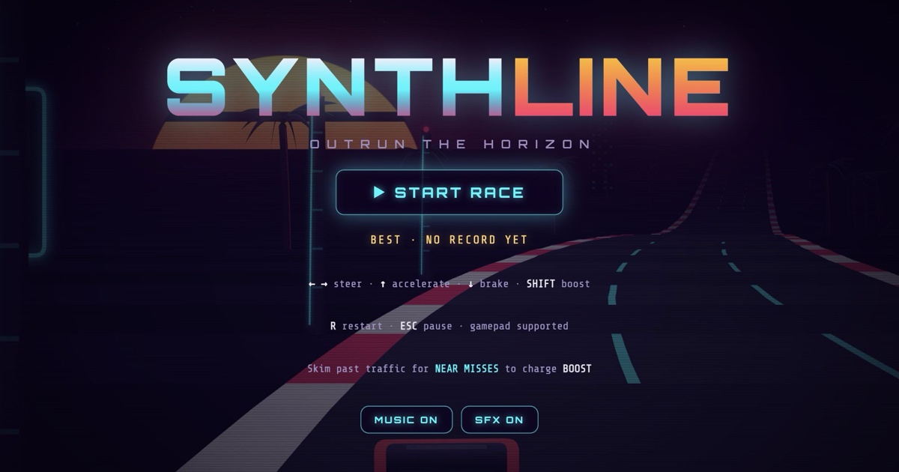

# SYNTHLINE

A synthwave arcade racer for the browser. Three laps on a pseudo-3D neon road,
traffic to thread, and a ghost of your best run to chase.

Play it at **https://shubhamtatvamasi.com/synthline/**



## The race

The track is a list of road segments projected from the camera, the classic
outrun technique. Curves bend the horizon. Hills lift and drop it. Fog swallows
the far end, and two mountain layers drift behind it. There are no image or
audio files to load: the cars, palms, pylons, buildings, sun, soundtrack, and
engine noise are generated at runtime with Canvas 2D and the Web Audio API.

Traffic cars wander between lanes and move aside when you close in. Hit one and
you lose speed. Pass close and you earn boost meter, which you can spend on a
higher top speed, a wider field of view, and exhaust flames. Your best race is
recorded and replayed as a translucent ghost on the next run.

Best lap, best race, and the ghost persist in `localStorage`. The HUD shows
your all-time best lap. The results screen lists every lap, your best lap, the
total, and the gap to your previous record.

## Controls

| Action     | Keyboard        | Gamepad            | Touch                    |
| ---------- | --------------- | ------------------ | ------------------------ |
| Steer      | ← → / A D       | Left stick / d-pad | ◀ ▶ pads                 |
| Accelerate | ↑ / W           | RT or A            | automatic                |
| Brake      | ↓ / S           | LT                 | BRAKE button             |
| Boost      | Shift / X       | B or X             | BOOST button             |
| Pause      | Esc / P         | Start              | ❚❚ button (top-left)     |
| Restart    | R               | none               | menu → RESTART           |
| Mute       | M               | none               | menu → MUSIC/SFX toggles |

The game pauses when the tab or window loses focus. Touch buttons capture the
pointer, so a finger can slide a little without dropping the input. The HUD and
touch controls respect safe-area insets.

## Built with

| Piece          | Choice                                                                 |
| -------------- | ---------------------------------------------------------------------- |
| Site framework | [Astro 7](https://astro.build), static output, one page                |
| UI / game host | [Svelte 5](https://svelte.dev) island with runes                       |
| Rendering      | Canvas 2D, segment-based pseudo-3D projection                          |
| Audio          | Web Audio API, look-ahead scheduled synthwave loop plus synthesized SFX |
| Fonts          | Orbitron and Share Tech Mono via Fontsource (self-hosted, SIL OFL)     |
| CI/CD          | GitHub Actions to GitHub Pages, gated by `astro check`                 |
| Share card     | Static Open Graph image plus canonical, OG, and Twitter metadata       |

The page bundle is about 220 KB with fonts, and the game code gzips to roughly
18 KB. Draw distance adapts at runtime on slower devices. Device pixel ratio is
capped at 2 to keep mobile GPUs happy. With `prefers-reduced-motion` set, screen
shake, star twinkle, and speed lines are turned off.

## Run locally

```bash
npm install
npm run dev        # http://localhost:4321/synthline/
npm run check      # type-check with astro check
npm run build      # static build into dist/
npm run preview    # serve the production build
```

Node 20 or newer (22 and 24 are both fine).

### Project layout

```
src/
├── components/Game.svelte   # UI island: HUD, menus, touch controls, canvas host
├── game/
│   ├── engine.ts            # state machine, physics, laps, traffic AI, ghost
│   ├── render.ts            # pseudo-3D renderer (sky, road, sprites, player)
│   ├── track.ts             # deterministic track, scenery, traffic spawns
│   ├── sprites.ts           # procedural art: cars, palms, pylons, sun, mountains
│   ├── audio.ts             # engine and wind synthesis, music scheduler, SFX
│   ├── input.ts             # keyboard, gamepad, and virtual touch input
│   ├── config.ts            # tuning constants and palette
│   ├── types.ts             # shared types
│   └── util.ts              # math and formatting helpers
├── layouts/Layout.astro     # document head, fonts, global styles
└── pages/index.astro        # the single game page
```

The running game is exposed as `window.__synthline` for debugging.

## Deploying to GitHub Pages

`.github/workflows/deploy.yml` type-checks the project on every push, then
builds and publishes the site. The build job will not run unless the check
passes.

**One-time setup**

1. Push the repository to GitHub.
2. Open **Settings → Pages → Build and deployment → Source** and choose
   **GitHub Actions**.
3. Push to `main`, or run the workflow from the **Actions** tab.

**URL path and repository name**

The page is served from the path configured as `base` in `astro.config.mjs`
(`/synthline`). That path normally matches the repository name. If you rename
the repository, update `base` and the URLs in `public/robots.txt` and
`public/sitemap.xml`; those two files are static and cannot read `base`.

**Custom domain**

The site is configured for `https://shubhamtatvamasi.com`. To give this project
its own subdomain instead, add `public/CNAME` with the hostname and set
`base: '/'` in `astro.config.mjs`.

`public/og.jpg` is the 1200 by 630 share image. Replace it when the artwork
changes.

## Credits

The projection follows the approach popularized by [Jake Gordon's
javascript-racer](https://github.com/jakesgordon/javascript-racer) (MIT).
Orbitron by Matt McInerney and Share Tech Mono by Carrois Apostrophe, served
through [Fontsource](https://fontsource.org).

## License

[MIT](./LICENSE) © Shubham Tatvamasi
